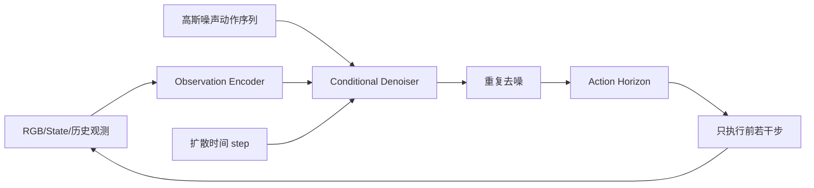

**论文**：[Diffusion Policy: Visuomotor Policy Learning via Action Diffusion](https://arxiv.org/abs/2303.04137) · **代码**：[real-stanford/diffusion_policy](https://github.com/real-stanford/diffusion_policy) · **类型**：算法教程（未在本站完成运行复现）。

## 1. 为什么行为克隆可能给出一个错误的平均动作？

比如桌面上有个障碍物，机器人向左绕和向右绕都能成功。若用均方误差直接回归动作，模型可能输出“两条路线的平均值”，恰好撞上障碍物。

扩散策略并不把所有示范压成一个平均结果，而是学习**在同一观测条件下的动作分布**。采样时从噪声出发，逐步变成一条满足当前观测的动作轨迹，天然更适合存在多种正确方式的任务。

## 2. 系统结构

视觉得来的 feature 是**条件**，去噪网络的主输入是带噪动作序列与 diffusion step。论文探讨的两个模型实现是时序 CNN 和时序 Diffusion Transformer；不要把它们混为唯一一种网络。

## 3. 数学原理：从动作到噪声，再学反方向

令 $A_0$ 表示真实动作序列，正向过程不断叠加高斯噪声：

$$
q(A_k\mid A_{k-1})=\mathcal N\left(\sqrt{1-\beta_k}A_{k-1},\beta_k I\right).
$$

利用重参数化，可直接采样某个噪声水平的动作：

$$
A_k=\sqrt{\bar\alpha_k}A_0+\sqrt{1-\bar\alpha_k}\,\epsilon,\qquad \epsilon\sim\mathcal N(0,I).
$$

通常采用噪声预测目标（此处为常用 DDPM 风格的教学表达；具体实验配置以官方代码为准）：

$$
\mathcal L_\epsilon=\mathbb E_{A_0,k,\epsilon}\left[\left\|\epsilon-\epsilon_\theta(A_k,k,o)\right\|_2^2\right].
$$

每个变量的含义：$o$ 是最近的观测，$k$ 是扩散步骤，$\epsilon_\theta$ 预测噪声，$A_k$ 的形状与 $A_0$ 一样，例如 $[B,H,D_a]$。回归误差并不是直接在原始图像上计算，而是在**动作序列**上计算。

## 4. “Action Horizon”和“只执行若干步”之间是什么关系？

模型预测未来 $H$ 步，但机器人执行其中较短的一段后重新观测。假设 $H=16$ 且每次执行 $E=4$ 步：模型第一次预测 16 步，只执行 4 步；得到新图像再预测另一段 16 步。这叫**滚动时域控制（receding horizon control）**。

优点是能根据接触变化重新规划。代价是需要处理推理时延，以及相邻 action chunk 不连续的问题。$H$ 和 $E$ 应通过任务与控制频率选择，而不是把论文默认值直接复制到新机器人上。

## 5. 为什么需要时序模型？

单帧动作回归容易忽略操作状态的历史。比如接插件已经预插一半，后续应该继续施力还是回退，不只取决于当前的一帧图像，还取决于之前的运动和接触变化。通过历史观测和未来轨迹联合建模，策略能表达连续动作的结构，但对力/触觉接触的可靠判断仍需要合适的传感器和训练数据。

## 6. 论文效果与需要谨慎的地方

原论文在 12 个操作任务、4 类 benchmark 中评测，作者报告相对既有方法的平均改进为 **46.9%**。这不是对任意现实机器人都必然提升 46.9% 的保证；不同 benchmark 的评测对象和成功条件不同，应阅读各任务表格与消融。

注意，上面的页面正文应该使用标准论文链接作为可点击来源；此处的作者数值在正式网站仍归类为**论文作者结果**，不是独立复现。

## 7. 代码入口与最小实验

官方仓库提供视觉和状态观测的 Colab、训练脚本与实验数据：[Diffusion Policy 源码](https://github.com/real-stanford/diffusion_policy)。阅读顺序建议是 observation encoder → dataset → diffusion model → policy action interface → evaluation runner。

最小实验：在二维 Push-T 或同等公开任务中，固定训练数据，对比直接 MSE-BC 与扩散策略；使用**同一套评测种子**统计成功率，并画出同一观测下多次采样的轨迹，判断是否确实存在多模态行为。未运行前，不能把计划实验写成已验证结论。

## 8. 与 π₀ 的关系

Diffusion Policy 和 π₀ 都属于条件生成连续动作的思路，但网络骨干和训练目标不同。Diffusion Policy 使用基于噪声去除的扩散建模；π₀ 将视觉语言大模型与 action expert 结合，用 Flow Matching 生成动作。理解动作张量 $[B,H,D_a]$、时间噪声变量与 rollout 循环后，再读 π₀ 会容易得多。

来源：[原始论文](https://arxiv.org/abs/2303.04137) · [项目页](https://diffusion-policy.cs.columbia.edu/) · [作者代码](https://github.com/real-stanford/diffusion_policy)。
