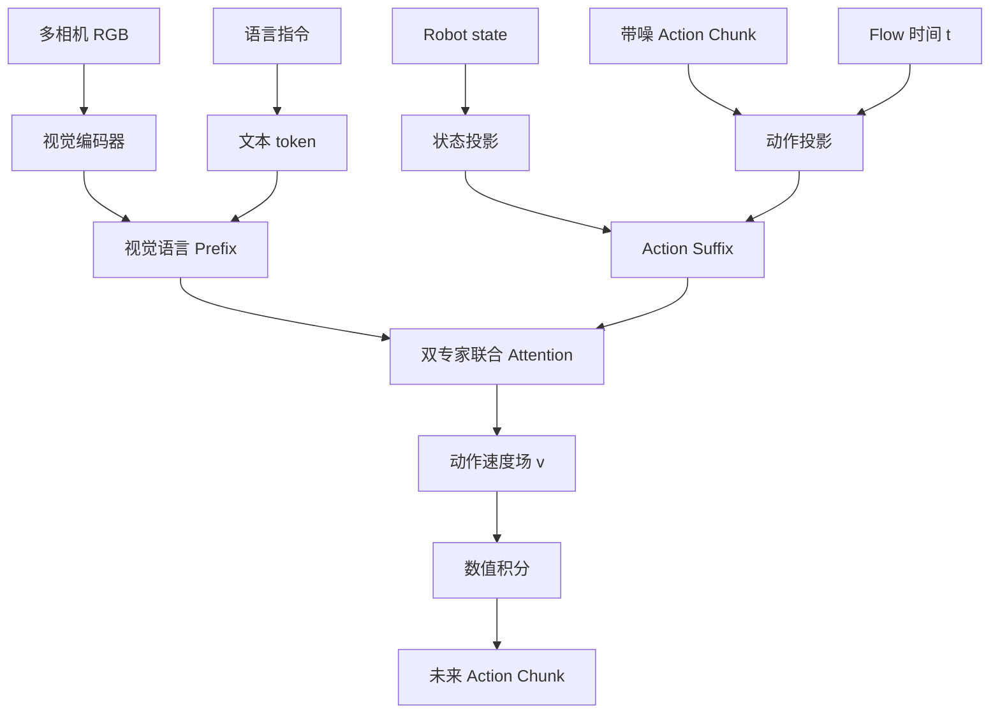

**论文**：[π₀: A Vision-Language-Action Flow Model for General Robot Control](https://arxiv.org/abs/2410.24164)（2024） · **代码**：[Physical-Intelligence/openpi](https://github.com/Physical-Intelligence/openpi) · **状态**：论文与源码解读，尚未完成复现实验。

## 1. 先看一个机器人任务

你告诉机器人“把红色杯子移到托盘里”。相机提供物体位置及场景，文本描述目标，机器人 state 包含当前关节和夹爪状态。模型需要输出的是一个时间区间内**连续的动作序列**，而不是一句指令。

这就产生两个问题：视觉语言模型擅长理解任务，却不天然掌握毫米级机器人动作；传统离散动作 token 虽能借助语言建模，却不总适合直接表达高维连续控制。π₀ 使用 **PaliGemma 的视觉语言上下文 + 单独的 action expert + 条件 Flow Matching** 来结合两类能力。

## 2. 架构图：Prefix 与 Suffix

**这里的双专家不是路由型 MoE。** PaliGemma 的视觉语言 Transformer 和较小的动作 Transformer 拥有不同参数，但动作 token 能在联合注意力中读取视觉语言上下文。上图中的“联合 Attention”是对多层实现的概括，不是模型末端才增加的独立单层模块。

### 输入与张量

以 openpi 常用默认设置为例：动作张量可以写成 $A\in\mathbb{R}^{B\times H\times D_a}$，其中 $H=50$、$D_a=32$。这是模型输入输出容器的设置，**不是所有机器人都有 32 个真实控制自由度**。

| 输入 | 示意形状 | 核心问题 |
| --- | --- | --- |
| 图像 | $[B,N,3,H_i,W_i]$ | 每个相机位置与归一化是否一致？ |
| 文本 token | $[B,L]$ | 指令如何 token 化？ |
| Robot state | $[B,D_s]$ | 是关节角还是末端位姿？ |
| 带噪动作 | $[B,50,32]$ | 维度/单位/参考坐标系是什么？ |
| 速度场输出 | $[B,50,32]$ | 对整个动作块回归 |

## 3. 为什么 Action Token 能读图像，图像却不能读噪声动作？

简化的 Prefix–Suffix 注意力可见性是：

| Query → Key | 图像与文本 Prefix | State / Action Suffix |
| --- | --- | --- |
| Prefix | ✓ | ✗ |
| Suffix | ✓ | ✓ |

这样视觉语言前缀在同一轮动作采样过程中不依赖随机动作变量，可以缓存 KV；动作 token 则持续利用观测条件。真实实现包含 padding mask 与 token 段规则，应核对 [`make_attn_mask`](https://github.com/Physical-Intelligence/openpi/blob/main/src/openpi/models/pi0.py) 而不是把整网误认为标准自回归 causal mask。

## 4. Flow Matching：网络预测的是“速度”，不是最终动作

给定真实动作块 $A$ 和噪声 $\epsilon\sim\mathcal{N}(0,I)$，构造一个在两者之间的中间状态（使用 openpi 方向约定）：

$$
x_t=(1-t)A+t\epsilon,\qquad u_t=\epsilon-A.
$$

训练让神经网络在观测 $o$ 条件下预测对应速度：

$$
\mathcal{L}_{\mathrm{FM}}=\mathbb{E}_{A,\epsilon,t}\left[\left\|v_\theta(x_t,t,o)-(\epsilon-A)\right\|_2^2\right].
$$

读懂这条公式：$A$ 是示范数据的真实动作；$\epsilon$ 是标准高斯随机动作；$t$ 表示混合程度；$v_\theta$ 输出与动作块同形状的向量。训练时不必先执行完整积分，只需要采一个 $t$ 和一段随机噪声，直接构造监督目标。

推理从纯噪声 $x_1$ 出发，沿负时间方向积分，例如 Euler 更新：

$$
x_{t-\Delta t}=x_t-\Delta t\,v_\theta(x_t,t,o).
$$

**动作长度 50 ≠ 积分次数 50。** 即使积分 10 次，每次更新的仍然是完整 $50\times32$ 动作张量。也不要把这里的 flow 当成图像光流。

## 5. 训练与源码怎么对应？

按照 [Pi0 源码](https://github.com/Physical-Intelligence/openpi/blob/main/src/openpi/models/pi0.py) 阅读：

1. `embed_prefix`：图像/语言如何构成 Prefix。
2. `embed_suffix`：state、带噪动作、时间嵌入怎样进入动作侧。
3. `compute_loss`：抽样 $t$、噪声与目标速度；构造 attention mask；计算动作回归损失。
4. `sample_actions`：缓存 Prefix；在每次流积分中处理 Suffix；输出动作块。
5. `pi0_config.py`：检查 action horizon、维度、模型变体与训练配置。

参数更新范围由实际训练配置决定，不能简单断言“始终冻结 PaliGemma”或“只更新动作专家”。论文结构、官方当前实现和某个微调实验应当分别描述。

## 6. 如何判断真的学会？

你至少要能解释：相机分辨率发生变化时会影响哪一层？为什么 32D 动作不等于 32 个关节？如果观测发生突变，为什么长 Action Chunk 开环执行风险更大？KV 缓存为什么依赖 Prefix 的遮蔽规则？

实际迁移到双臂平台时，优先核对机器人动作空间、坐标系、归一化、控制频率，以及执行端是否具备接触安全限制。EGO 视频没有可执行机器人动作标签时，**不能直接套用标准监督 Flow Matching 目标**。

## 7. 实验与局限

原论文报告了跨多机器人形态及复杂操作的实验，并包含针对任务的适配结果。这支持作者提出的架构具有多任务操作潜力，但不意味着任意目标机器人无需微调便能达到同样表现。部署性能还取决于训练数据、action schema、运行时延和闭环重规划。

**下一步可验证实验**：固定同一机器人数据和训练预算，仅改变积分步数（例如 5/10/20），记录动作采样时延、实际执行成功率和碰撞/接触错误。本文没有实际运行该消融，不把它当成既有实验结论。

**附**：之前的 [π₀ 扩展草稿](https://github.com/saranna-hub/Embodied-AI-Roadmap/blob/main/docs/papers/pi-series/pi0-deep-dive.md) 暂时保留供对照；正式课程以此 Markdown 单一来源维护。
